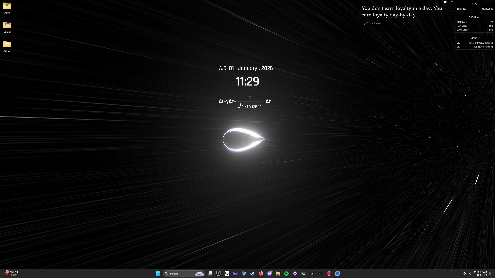
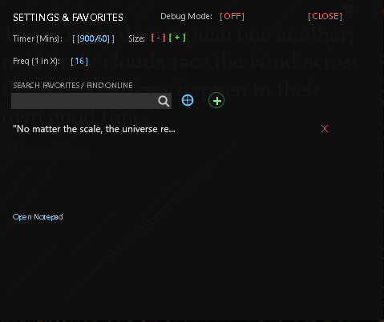

# Smart Quotes

**Interactive quote manager for Rainmeter** — fetch inspiration from the web, save favorites locally, and curate a personal library without leaving your desktop.

Built as a heavily expanded successor to [Static Quotes](https://github.com/alestrunda/static-quotes) by [alestrunda](https://github.com/alestrunda).

   

## Gallery

<p align="center">
  
</p>
<p align="center"><b>Desktop context</b> — the widget blends into a full Rainmeter setup.</p>

<p align="center">
  
  
</p>
<p align="center"><b>Left:</b> main quote display &nbsp;·&nbsp; <b>Right:</b> settings &amp; favorites library</p>

## Features

### Smart quote engine
- Pulls random quotes from the [ZenQuotes API](https://zenquotes.io/)
- **Favorite rate** — show a saved quote every *N* refreshes (or always favor favorites)
- Cleans API noise (HTML entities, line breaks, wrapping issues)

### Favorites library
- Heart icon saves or removes the current quote
- Gold star when the on-screen quote is already saved
- Search, scroll, and delete entries in the settings menu
- Optional direct edit of `Favorites.txt` in Notepad

### Custom quotes & research
- **+** opens a quote + author form
- Globe control searches Google for quotes by author/topic
- Sample favorites ship with the skin so the library is never empty on first run

### Look & feel
- Dynamic scale controls (clamped so the UI stays usable)
- Refresh interval in minutes, edited in-place
- Menu open/closed state persists across refreshes
- Hover hit targets on heart, gear, zoom, and list actions

## Requirements

- Windows
- [Rainmeter](https://www.rainmeter.net/) 4.5 or newer (InputText plugin is built-in)
- Network access for ZenQuotes / optional web search

## Installation

1. Install [Rainmeter](https://www.rainmeter.net/) if you have not already.
2. Download the latest **Release** ZIP (or clone this repository).
3. Copy the `Smart-Quotes` folder into your skins directory, typically:

   `Documents\Rainmeter\Skins\Smart-Quotes\`

4. In Rainmeter **Manage** → **Skins** → **Smart-Quotes** → load **`SmartQuotes.ini`**.

> The active skin file is **`SmartQuotes.ini`** (not the legacy `StaticQuote.ini` name).

## Controls

| Action | What it does |
|--------|----------------|
| **Heart** | Toggle favorite for the current quote |
| **Gear** | Open settings & library |
| **Quote text / background** | Fetch a new quote immediately |
| **Refresh (min)** | Set auto-rotate interval (minutes) |
| **Favorite rate** | `1` = always favorites; `N` = favorite every *N*th refresh; `0` = online only |
| **Scale − / +** | Resize the whole UI (about 0.4–1.6) |
| **Search bar** | Filter the favorites list |
| **Globe** | Type an author/topic → Google “quotes by …” |
| **+** | Add a custom quote and author |
| **✕** on a row | Delete that favorite |
| **Edit .txt File** | Open `Favorites.txt` in Notepad |
| **Scroll wheel** (over menu) | Scroll the favorites list |

## Files

| File | Role |
|------|------|
| `SmartQuotes.ini` | Skin layout, measures, UI |
| `logic.lua` | Favorites I/O, API parse, menu logic |
| `Favorites.txt` | Local quote database (one `"quote" - Author` per line) |
| `Screenshots/` | README gallery images |

## Favorites format

```text
"Be the change that you want to see in the world." - Mahatma Gandhi
"Good judgment comes from experience, and experience comes from bad judgment." - Rita Mae Brown
```

Use a straight double-quoted quote, then ` - ` (space-hyphen-space), then the author. The last ` - ` on the line is treated as the separator so quotes may contain hyphens.

## Configuration notes

Defaults live under `[Variables]` in `SmartQuotes.ini`:

| Variable | Default | Meaning |
|----------|---------|---------|
| `Scale` | `0.8` | UI scale factor |
| `CurrentTimer` | `900` | Refresh interval in **seconds** (15 min) |
| `RecycleFrequency` | `16` | Show a favorite every N refreshes |
| `URL` | ZenQuotes random endpoint | WebParser source |

## Credits

- **Original concept:** [Static Quotes](https://github.com/alestrunda/static-quotes) by [alestrunda](https://github.com/alestrunda)
- **Quotes API:** [ZenQuotes.io](https://zenquotes.io/)
- **Maintainer:** [Stelliro](https://github.com/Stelliro)

## License

[Creative Commons Attribution-NonCommercial-ShareAlike 3.0 Unported (CC BY-NC-SA 3.0)](https://creativecommons.org/licenses/by-nc-sa/3.0/)

You may share and adapt the work with attribution, for non-commercial use, under the same license. See [LICENSE](LICENSE) for the full legal text.

## Changelog

### 1.1.0
- Renamed skin entrypoint to `SmartQuotes.ini`
- Restored add-quote panel, web-search globe, and favorites list wiring after redesign
- Fixed numeric InputText anchors, heart favorite tint, timer minutes display, scale clamping
- Removed unused legacy `changeQuote.lua`
- README, metadata, topics, and release packaging refresh
